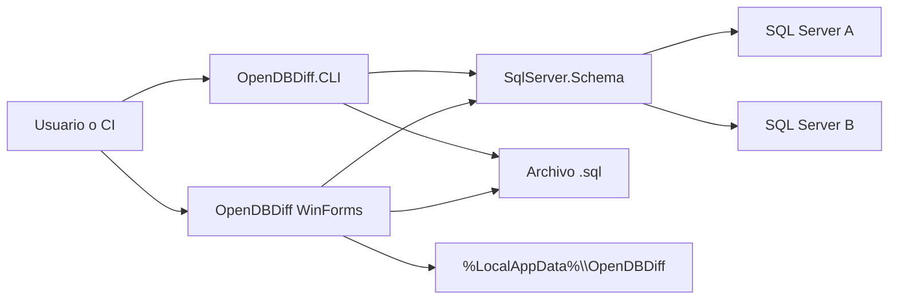

# Arquitectura de OpenDBDiff

## 1. Propósito

OpenDBDiff compara el **esquema** de dos bases de datos Microsoft SQL Server (2005 en adelante, incluido Azure SQL en un subconjunto de objetos) y produce un script T-SQL para llevar una hacia la otra.

No es un replicador de datos. La comparación de filas existe como función auxiliar de la GUI (`DataCompareForm`) sobre una tabla concreta, no como motor principal.

## 2. Principios de diseño

| Principio | Cómo se aplica |
|---|---|
| Separación de contratos y motor | `Abstractions.Schema` y `Abstractions.Ui` no conocen SQL Server |
| Un host, varios adaptadores | La GUI habla con `IProjectHandler`; hoy solo hay SQL Server |
| Modelo en memoria | El catálogo se materializa en `Database` + `SchemaList` |
| Diff por estado, no por parche binario | Cada objeto recibe `ObjectStatus` (Create, Drop, Alter, Rebuild…) |
| Script ordenado | `SQLScript` se ordena por profundidad, `ScriptAction` y dependencias |
| Sin SMO | Lectura y ejecución usan ADO.NET (`SqlConnection` / `SqlCommand`) |

## 3. Vista de contexto



El usuario elige dos connection strings. El motor lee metadatos de `sys.*`, construye dos grafos de objetos, marca diferencias y emite T-SQL. La GUI además persiste proyectos y última configuración en LiteDB.

## 4. Estructura de la solución

Solución: [`OpenDBDiff.sln`](../OpenDBDiff.sln). Target uniforme: **.NET Framework 4.5.2**.

| Proyecto | Tipo | Responsabilidad |
|---|---|---|
| `OpenDBDiff` | WinExe | Shell WinForms, árbol, editor de script, proyectos |
| `OpenDBDiff.CLI` | Exe | Comparación headless |
| `OpenDBDiff.Abstractions.Schema` | Library | Contratos y tipos de esquema agnósticos de motor |
| `OpenDBDiff.Abstractions.Ui` | Library | Contratos de UI (conexión, generador, comparador) |
| `OpenDBDiff.SqlServer.Schema` | Library | Lectura, comparación y generación T-SQL |
| `OpenDBDiff.SqlServer.Ui` | Library | Adaptador SQL Server para la GUI |
| `OpenDBDiff.Tests` | MSTest | Pruebas unitarias del motor |

### Dependencias entre proyectos

```
OpenDBDiff (GUI)
  ├── Abstractions.Schema
  ├── SqlServer.Schema → Abstractions.Schema (clasificación y validación de tablas en memoria)
  ├── Abstractions.Ui → Abstractions.Schema
  └── SqlServer.Ui
        ├── Abstractions.Schema
        ├── Abstractions.Ui
        └── SqlServer.Schema → Abstractions.Schema

OpenDBDiff.CLI
  ├── Abstractions.Schema
  └── SqlServer.Schema

OpenDBDiff.Tests
  ├── Abstractions.Schema
  └── SqlServer.Schema
```

La CLI **no** referencia la capa UI: reutiliza el mismo motor que la GUI.

## 5. Capas

### 5.1 Abstractions.Schema

Núcleo portable:

- `ISchemaBase` / `SchemaBase`: identidad, `Status`, `ToSql()`, `ToSqlDiff()`, `Clone()`.
- `IDatabase`: raíz del modelo, opciones, `Find()`, `ToSqlDiff()`.
- `SchemaList<T,P>`: colección indexada por `FullName`, respeta filtros.
- `SQLScript` / `SQLScriptList`: fragmentos de script ordenables.
- Enums `ObjectType`, `ObjectStatus`, `ScriptAction`.
- `SchemaException`, eventos de progreso, `SchemaNodeAttribute` (metadatos del árbol UI).

### 5.2 Abstractions.Ui

Puente entre el shell y un motor concreto:

- `IProjectHandler`: fábrica de selectores, generadores, comparador y opciones.
- `IFront`: control WinForms de conexión.
- `IGenerator`: `Process()` + progreso.
- `IDatabaseComparer`: `Compare(origin, destination)`.
- `OptionControl`: panel de opciones.

### 5.3 SqlServer.Schema (motor)

Tres paquetes internos:

1. **Generates** — lee el catálogo (`Generate`, `GenerateTables`, `GenerateViews`, …) con SQL embebido en `SQLQueries/` y `Generates/SQLCommands/`.
2. **Compare** — `CompareDatabase` + `CompareBase<T>` + comparadores por tipo.
3. **Model** — `Database`, `Table`, `Code`, `StoredProcedure`, `View`, etc.

Opciones: `SqlOption` (Ignore, Filters, Comparison, Defaults, Script).

### 5.4 SqlServer.Ui

Implementación concreta para WinForms:

- `SQLServerProjectHandler`
- `SqlServerConnectFront`
- `SQLServerGenerator` / `SQLServerComparer`
- `SqlOptionsFront`

### 5.5 Hosts

- **GUI:** `Program.Main` → `MainForm`. Orquesta progreso, árbol (`SchemaTreeView`), DiffPlex, ScintillaNET, LiteDB.
- **CLI:** `Program.Main` → CommandLineParser → `Generate.Process` × 2 → `Compare` → `ToSqlDiff`.

## 6. Flujo arquitectónico

1. **Ingesta:** dos `Generate.Process()` construyen dos `Database`.
2. **Grafo:** `BuildDependency()` indexa FK, índices y dependencias de objetos de código.
3. **Diff:** `CompareDatabase.GenerateDifferences(origin, destination)` muta `origin` con `ObjectStatus`.
4. **Script:** `Database.ToSqlDiff()` recorre colecciones en orden fijo; cada objeto emite `SQLScript`.
5. **Ordenación:** `SQLScriptList.Sort()` por `Deep`, `ScriptAction` y peso de dependencias.
6. **Presentación o persistencia:** editor / archivo / stdout.

Detalle de secuencia: [diagramas/02-secuencia.md](diagramas/02-secuencia.md).  
Detalle de flujo: [diagramas/03-flujo.md](diagramas/03-flujo.md).

## 7. Convención origen / destino

Es la decisión de diseño más fácil de malinterpretar.

| Capa | Nombre | Significado |
|---|---|---|
| Motor (`CompareDatabase`) | `origin` | Esquema **antes** de aplicar el script |
| Motor | `destination` | Esquema **después** (estado deseado) |
| GUI izquierda | Source selector | Estado **deseado** (destination del motor) |
| GUI derecha | Destination selector | Estado **actual** (origin del motor) |
| CLI `--before` | origin | Estado anterior |
| CLI `--after` | destination | Estado deseado |

El comentario en `MainForm.StartComparison` lo deja explícito: el script migra la base **derecha** hacia la **izquierda**.

Cabecera del script generado (`Database.ToSqlDiff`):

> This script performs actions to change the Destination schema to the Source schema.

## 8. Tipos de objeto soportados

El modelo cubre el inventario anunciado en el README:

- Tablas, columnas (computed, identity, XML), opciones de tabla
- Constraints e índices (incluidos XML e índices full-text)
- XML schemas, table types, UDT
- CLR: assemblies, CLR-UDT, CLR procedures, CLR triggers
- Triggers y DDL triggers
- Synonyms, schemas, filegroups
- Views, functions, stored procedures
- Partition functions / schemes
- Users y roles
- Extended properties, rules, defaults, full-text catalogs

Azure SQL (`SQLServerAzure10`) omite partitions, filegroups, assemblies y full-text en la carga.

## 9. Extensibilidad

No hay plugins dinámicos (ni MEF ni carga de assemblies en runtime).

El diseño **permite** otro motor (por ejemplo Sybase, con código comentado en `MainForm`) si se implementan:

1. Un proyecto análogo a `SqlServer.Schema`.
2. Un `IProjectHandler` análogo a `SQLServerProjectHandler`.
3. El registro en `MainForm.LoadProjectHandlers()`.

`XmlConfig/ConfigProviders` lee un `OpenDBDiffConfig.xml` que **no existe** en el repositorio y no está cableado al arranque.

## 10. Persistencia y configuración

| Dato | Almacén |
|---|---|
| Proyectos y última conexión | LiteDB `%LocalAppData%\OpenDBDiff\settings.liteDb` |
| Opciones de comparación | `SqlOption` en memoria; se pueden serializar con el proyecto |
| Filtros de objetos | `SqlOptionFilter` (patrones por `ObjectType`) |
| Log de excepciones de esquema | `%TEMP%\OpenDBDiff.log` (`SchemaException`) |

## 11. Concurrencia

La comparación corre **en el hilo de UI** dentro de `ProgressForm_Activated`. Existe código comentado en `Generate.Process` para tres hilos paralelos; no está activo. No hay `async/await` ni `BackgroundWorker` en el pipeline principal.

## 12. Calidad y entrega

- Pruebas: MSTest + Moq sobre utilidades y un subconjunto de columnas/código.
- CI: AppVeyor (`appveyor.yml`), imagen Visual Studio 2019, `nuget restore`, build Release, artefactos GUI y CLI.
- El proyecto de tests no se ejecuta de forma explícita en el YAML de CI.
- Licencia: GNU GPL v2.

## 13. Riesgos y límites arquitectónicos

- Acoplamiento fuerte a catálogos `sys.*` de SQL Server; cada versión nueva puede exigir queries distintas (`GetTriggers.SQLServerAzure10.sql`, etc.).
- `ObjectStatus` y `ScriptAction` son enums densos; algunos valores de `ScriptAction` se solapan a propósito (`AddView` = `AddFunction`).
- El CLI no expone `SqlOption`; siempre usa el constructor por defecto.
- La GUI bloquea mientras lee y compara bases grandes.
- No hay capa de aplicación de scripts transaccional completa: `Updater` ejecuta fragmentos sueltos contra la conexión derecha.

## 14. Diagrama de componentes

Ver [diagramas/01-arquitectura.md](diagramas/01-arquitectura.md) para la vista Mermaid completa de capas, NuGet y contratos.


## Tablas optimizadas para memoria

La GUI referencia explícitamente `SqlServer.Schema` para clasificar las tablas y mostrar las razones de bloqueo. La selección de proveedor y los contratos existentes siguen pasando por `IProjectHandler`.

El modelo mantiene una sola colección `Database.Tables`, con `IsMemoryOptimized` y `Durability`. `SchemaTreeView` divide su presentación en dos grupos; no añade colecciones duplicadas a la reflexión del modelo. `MemoryOptimizedTableSql` centraliza definiciones y prevalidación antes de construir o ejecutar cambios. La comparación conserva una instantánea original y una definición deseada para las tablas en memoria.

Los fallos de lectura de tablas/columnas/restricciones/índices abortan la comparación; los bloqueos de generación mantienen disponible el árbol. Detalles y límites: [TablasEnMemoria.md](TablasEnMemoria.md).
