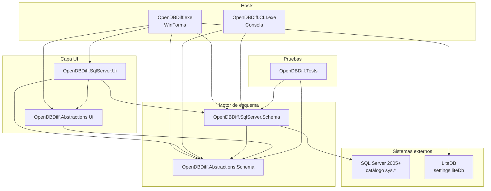
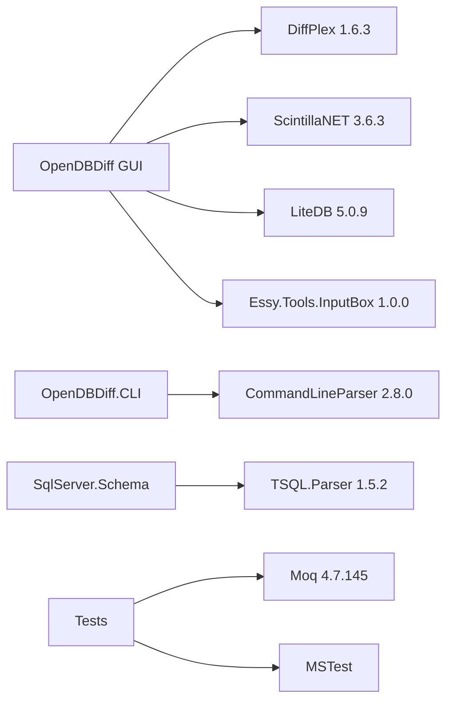
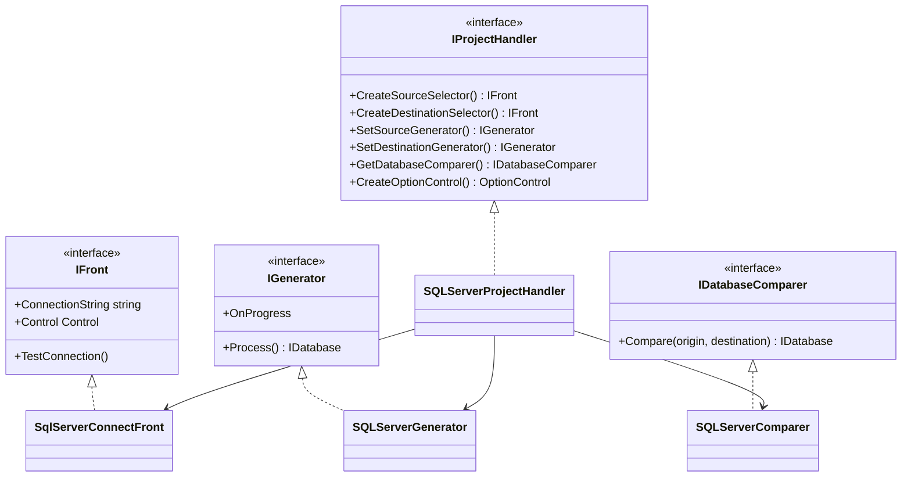
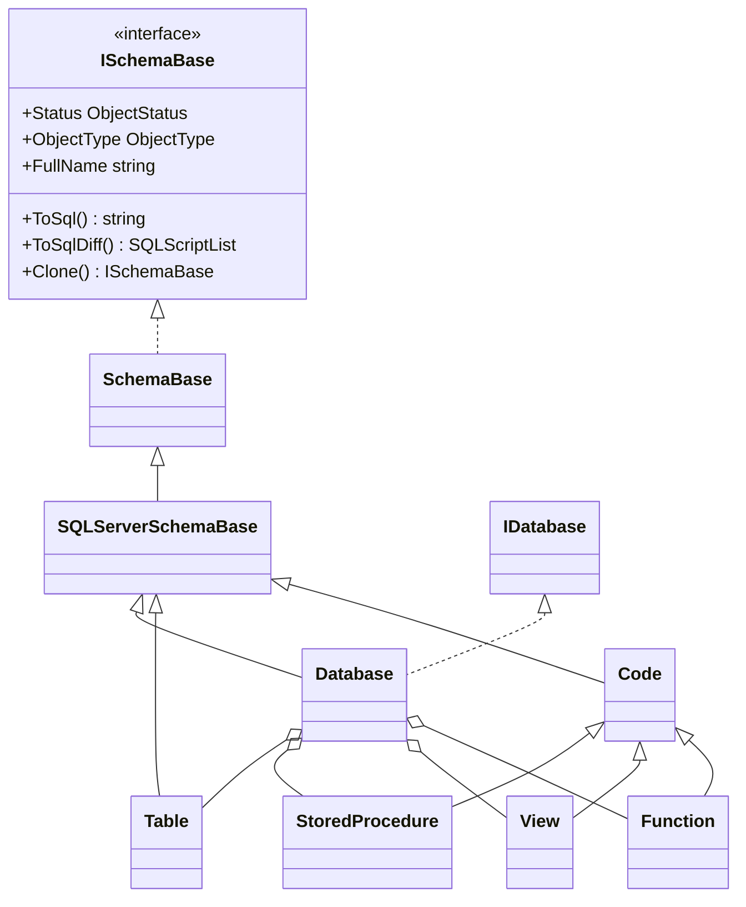

# Diagrama de arquitectura

Vista de componentes, capas y dependencias de OpenDBDiff. Los diagramas se renderizan en GitHub, VS Code y cualquier visor Markdown con soporte Mermaid.

## Capas y proyectos

## Dependencias de paquetes NuGet

## Contratos de extensibilidad UI

La selección del proveedor usa interfaces y un handler registrado (`SQLServerProjectHandler`). La clasificación de tablas en memoria y sus motivos de bloqueo usan también una referencia directa al motor SQL Server.

## Modelo de dominio (resumen)

