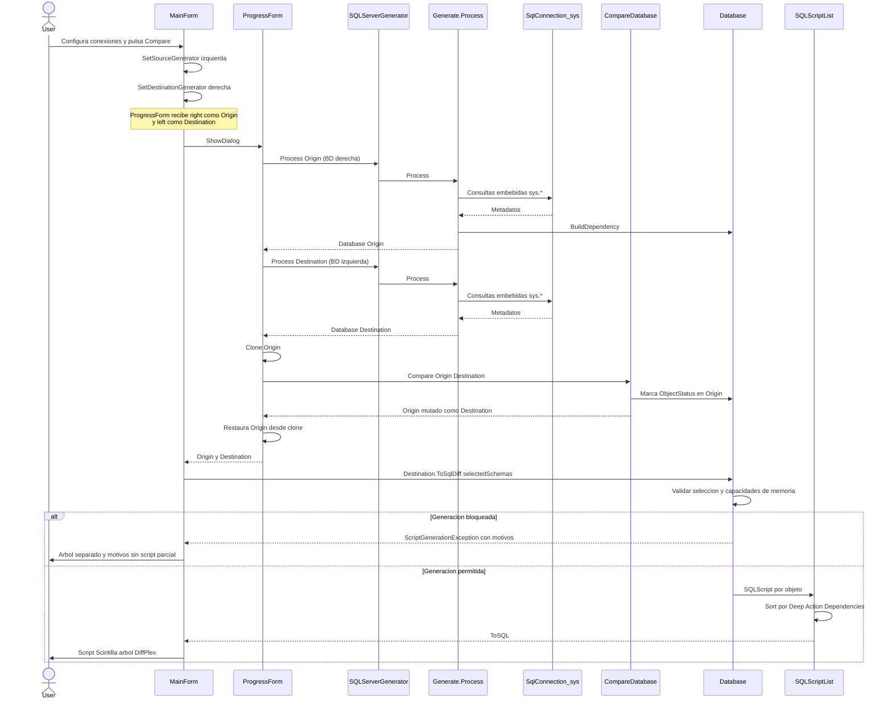
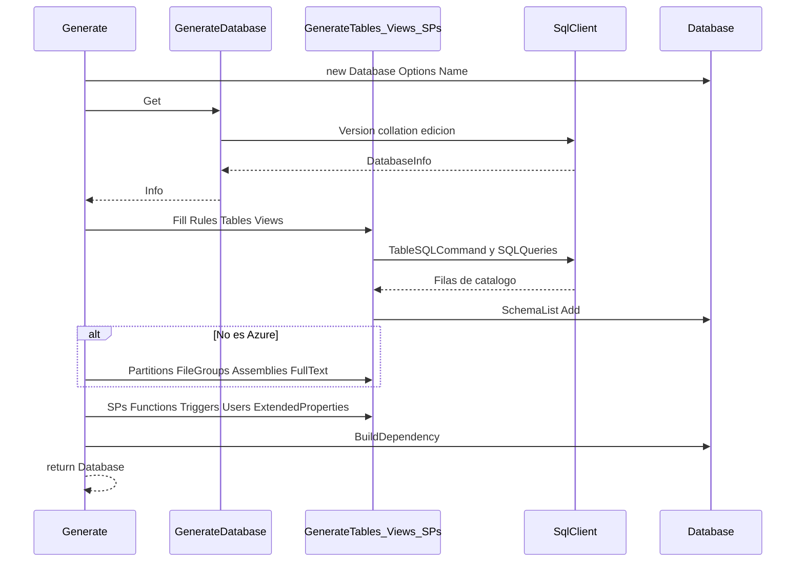
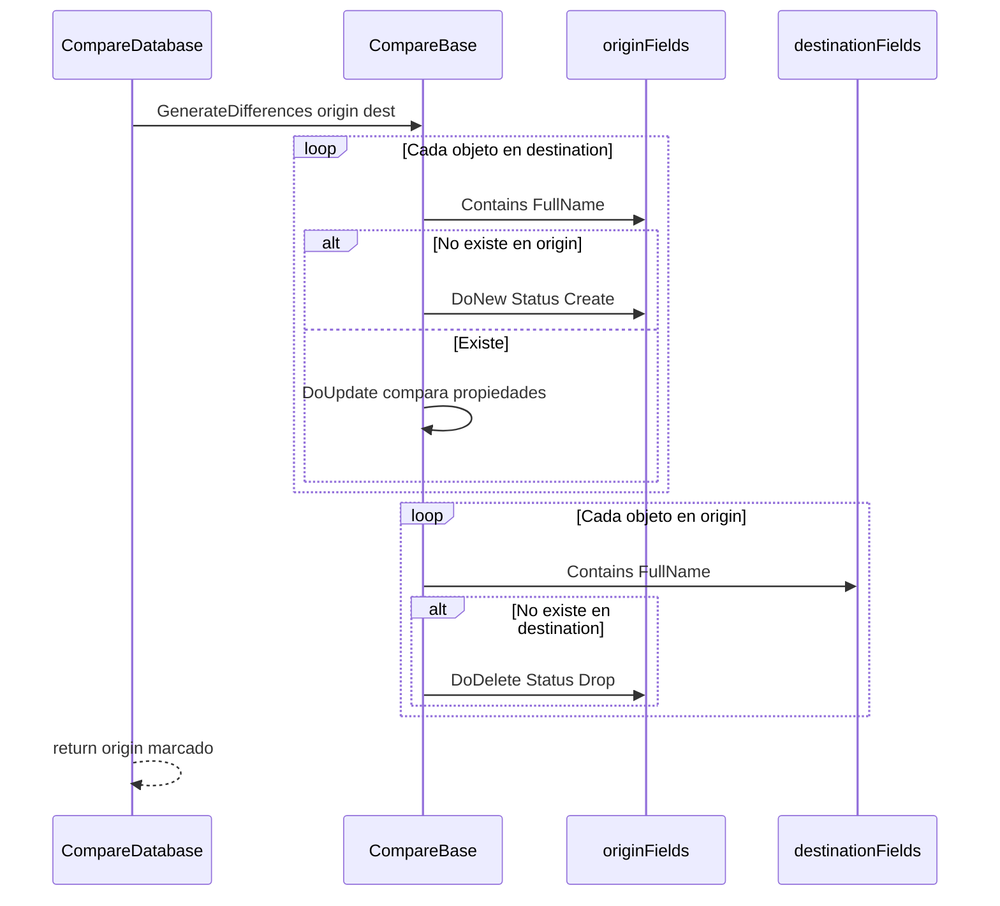
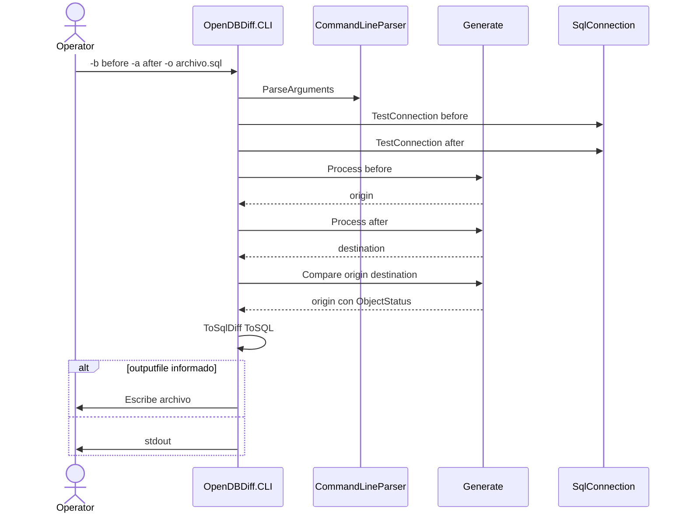

# Diagrama de secuencia

Comparación de dos bases de datos y generación del script T-SQL de sincronización, tal como ocurre en la GUI.

## Comparación GUI (end-to-end)

En la interfaz:

- **Izquierda (Source selector):** esquema destino de la migración (estado deseado).
- **Derecha (Destination selector):** esquema origen (estado actual).
- El script transforma **derecha → izquierda**.

## Carga de un esquema (`Generate.Process`)

## Algoritmo de comparación (`CompareBase`)

## Flujo CLI

