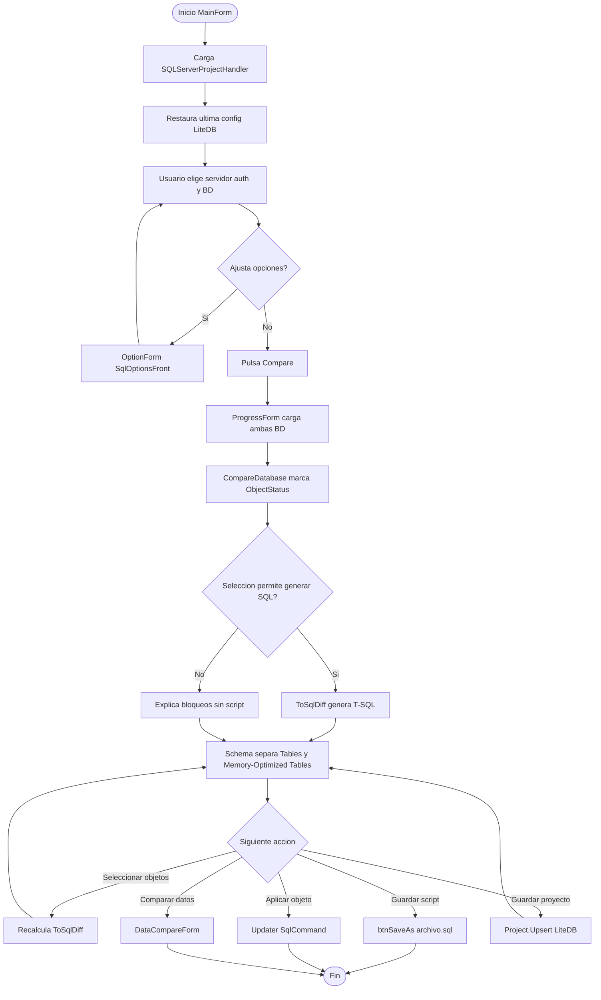
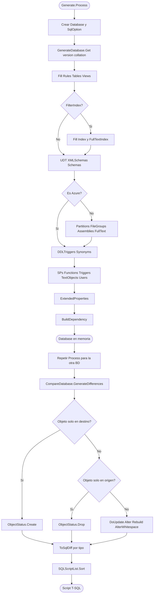
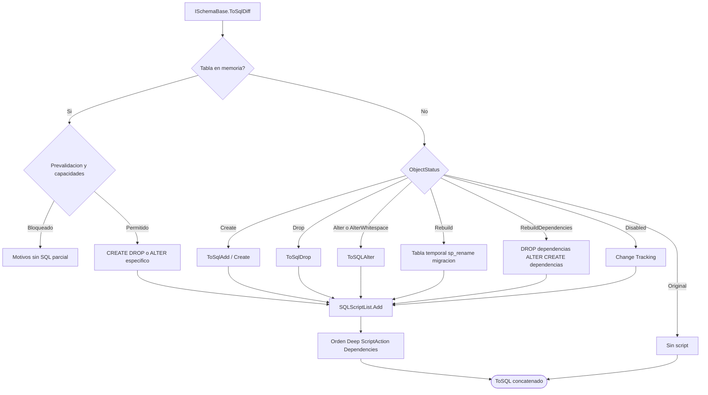
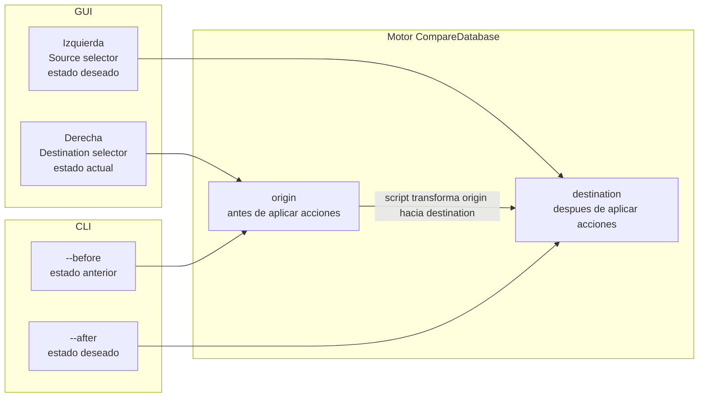

# Diagramas de flujo

## Flujo de usuario (GUI)

## Flujo del motor de comparación

## Flujo de generación SQL por objeto

## Convención origen / destino

La nomenclatura cambia según la capa. Este flujo aclara el sentido del script.

