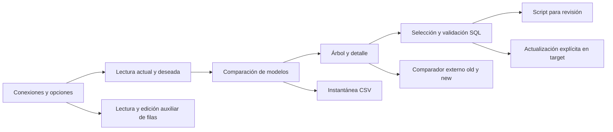

# Mapa de capacidades

División aceptada por el usuario durante la planificación; los IDs permanecen estables. Dependencias funcionales (no equivalen exactamente a referencias de ensamblados):

| ID | Responsabilidad | Depende de |
|---|---|---|
| lectura-modelo | Contratos de objetos, carga SQL y progreso | — |
| configuracion-conexiones | Opciones, selectores, perfiles y almacenamiento | lectura-modelo (contratos de opciones) |
| comparacion | Modelo marcado con diferencias | lectura-modelo |
| sincronizacion | Validación, emisión y aplicación de cambios | comparacion |
| reportes-externo | CSV y definiciones para herramienta externa | comparacion, configuracion-conexiones |
| datos-auxiliares | Lectura y edición manual de filas de una tabla | lectura-modelo |
| interfaz-cli | Flujos de usuario y orquestación de hosts | Todas las anteriores; CLI usa solo lectura/comparación/generación |

Orden de documentación y caracterización: contratos de lectura-modelo → configuración/comparación → sincronización/reportes/datos auxiliares → hosts. Los datos auxiliares se separaron como anexo porque tienen escrituras y riesgos distintos; pertenecen al alcance funcional actual aprobado.

## Flujo principal

CSV no depende de los nodos del árbol ni de la posibilidad de generar SQL. La edición de filas es otra operación: no alimenta `changed item data` del reporte.
